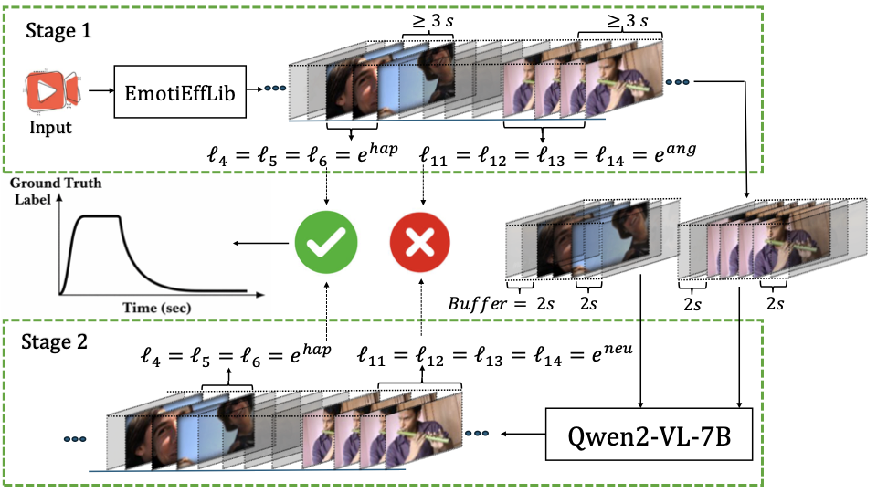
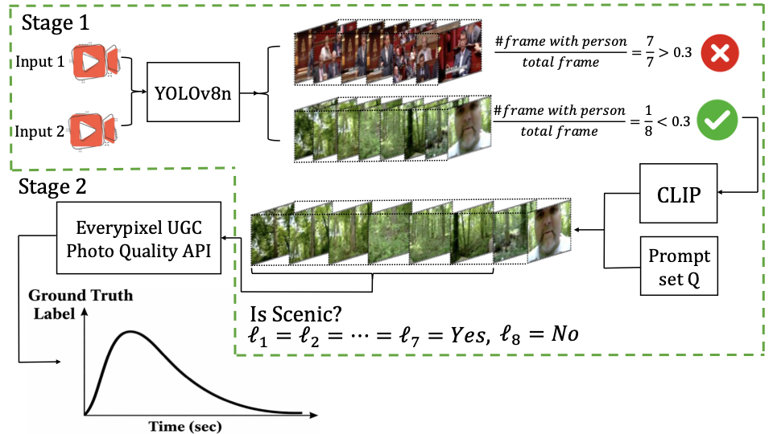

<p align="center">
  
</p>

# TRINITY: A Multi-Perspective Benchmark for Personal-Style Video Highlight Detection (ECCV 2026)

<div align="center">

[](https://github.com/vanilladucky/TRINITY)
[](https://huggingface.co/datasets/vanilladucky/TRINITY)
[](LICENSE)

Qianqian Chen\*, Hyun Bin Kim\*, Denzel Elden Wijaya, Yang Yi, Bo Liu<sup>✉</sup>, and Yangkai Ding<sup>✉</sup>

Huawei Technologies Co., Ltd.

<sup>\*</sup>Equal Contribution. <sup>✉</sup>Corresponding Author.

</div>

Official PyTorch implementation of **TRINITY**, a multi-perspective benchmark that decomposes video highlight saliency into three complementary perspectives — **Event**, **Emotion**, and **Nature** — within a unified temporal framework, together with a shared-backbone, multi-branch architecture that predicts all three perspectives in parallel from a single input sequence.

> Traditional video highlight detection relies on a narrow, event-centric definition of saliency, which often fails to generalize to unconstrained personal videos where highlights are heterogeneous and perspective-dependent. TRINITY addresses this by decomposing highlight saliency into Event, Emotion, and Nature perspectives, and proposes a shared-backbone multi-branch architecture with view-specific experts for parallel multi-perspective prediction.

<table>
<tr>
<td></td>
<td></td>
</tr>
</table>

## 📢 News

- **[June 2026]** Code and the TRINITY dataset are publicly released.

## Table of Contents

- [🛠️ Installation](#installation)
- [🗂️ Dataset](#dataset)
- [🏗️ Model](#model)
- [🏋️ Training](#training)
- [🧪 Evaluation](#evaluation)
- [📝 Citation](#citation)
- [🙏 Acknowledgements](#acknowledgements)
- [⚖️ License](#license)

## 🛠️ Installation

```bash
git clone https://github.com/vanilladucky/TRINITY.git
cd TRINITY
conda create -n trinity python=3.10 -y
conda activate trinity
pip install -r requirements.txt
```

Tested with Python 3.8.8, PyTorch 1.13.1, and CUDA 11.7. A single modern GPU (tested with NVIDIA GeForce RTX 3090) is sufficient, since the model operates on pre-extracted 512-dim CLIP ViT-B/32 features rather than raw video.

## 🗂️ Dataset

The TRINITY benchmark — pre-extracted CLIP ViT-B/32 features, ground truth, and splits for the Event, Emotion, and Nature perspectives — is hosted on Hugging Face:

**[https://huggingface.co/datasets/vanilladucky/TRINITY](https://huggingface.co/datasets/vanilladucky/TRINITY)**

Each perspective ships as numbered zip shards of per-video `.npz` (and, for Nature ground truth, `.json`) files, plus a single split file:

| Perspective | Features | Ground truth | Split file |
|---|---|---|---|
| Event | `event/event_features_part_{1..145}.zip` — `video_<id>.npz`, key `"data"`, shape `(T, 512)`, float32, 1 fps | `event/event_gt_part_1.zip` — `video_<id>.npz`, key `"data"`, frame-level replay-saliency scores | `mr_hisum_split_original.json` (27,892 / 2,000 / 2,000 train/val/test) |
| Emotion | `emotion/emotion_features_part_{1..11}.zip` — `<clip_id>.npz`, key `"features"`, shape `(T, 512)`, float16 | `emotion/emotion_gt_part_1.zip` — `<clip_id>.npz` with `labels`, `clip_start`, `clip_end`, `clip_duration`, `num_segments`, `segment_duration`, `is_negative` | `emotion_split.json` (16,178 / 1,759 / 1,600) |
| Nature | `nature/nature_feat_part_{1..32}.zip` — `<video_id>.npz`, key `"features"`, shape `(T, 512)`, float16 (includes `_aug` variants), 1 fps | `nature/nature_gt_part_1.zip` — `<video_id>.json`, a list of per-frame aesthetic scores in `[0, 1]` | `nature_split.json` (12,763 / 874 / 1,903) |

> **Note**: For the Event perspective, ground-truth highlight scores follow the replay-based "Most Replayed" supervision introduced by Mr. HiSum; TRINITY adopts its annotations directly rather than re-deriving them.

### Downloading

```bash
pip install huggingface_hub
python download_data.py --perspectives event,emotion,nature --data-root data
```

This populates `data/` in the flat per-perspective layout expected by [`model/full_dataset.py`](model/full_dataset.py) (feature/ground-truth shards extracted, split files downloaded). It's idempotent — re-running skips shards already extracted, so it's safe to call repeatedly on a persistent volume. Use `--perspectives` to download a subset, e.g. `--perspectives event`.

Each feature/ground-truth `.npz` can then be loaded directly with NumPy:

```python
import numpy as np
feat = np.load("data/event/event_features/video_1.npz")["data"]  # (T, 512)
```

### Setting dataset paths

[`model/full_dataset.py`](model/full_dataset.py) reads all data through environment variables, falling back to `data/<perspective>/...` (relative to `TRINITY_DATA_ROOT`, default `data`) if unset — which is exactly the layout `download_data.py` produces. If you ran the download command above with the default `--data-root data` from the repository root, the defaults already work and you can skip straight to [Training](#training).

Otherwise, paste this right after downloading to point everything at your actual data location:

```bash
export TRINITY_DATA_ROOT=data

export TRINITY_EVENT_SPLIT=$TRINITY_DATA_ROOT/event/mr_hisum_split_original.json
export TRINITY_EVENT_FEATURES=$TRINITY_DATA_ROOT/event/event_features
export TRINITY_EVENT_GT=$TRINITY_DATA_ROOT/event/event_gt

export TRINITY_EMOTION_SPLIT=$TRINITY_DATA_ROOT/emotion/emotion_split.json
export TRINITY_EMOTION_FEATURES=$TRINITY_DATA_ROOT/emotion/features
export TRINITY_EMOTION_GT=$TRINITY_DATA_ROOT/emotion/ground_truth

export TRINITY_NATURE_SPLIT=$TRINITY_DATA_ROOT/nature/nature_split.json
export TRINITY_NATURE_FEATURES=$TRINITY_DATA_ROOT/nature/features
export TRINITY_NATURE_GT=$TRINITY_DATA_ROOT/nature/ground_truth
```

Just change `TRINITY_DATA_ROOT` on the first line if your `data/` directory lives somewhere other than the repository root, or override any individual variable to point at a custom location:

| Variable | Default | Description |
|---|---|---|
| `TRINITY_DATA_ROOT` | `data` | Root directory all other defaults are computed relative to |
| `TRINITY_EVENT_SPLIT` | `$TRINITY_DATA_ROOT/event/mr_hisum_split_original.json` | Event split file |
| `TRINITY_EVENT_FEATURES` | `$TRINITY_DATA_ROOT/event/event_features` | Event feature `.npz` directory |
| `TRINITY_EVENT_GT` | `$TRINITY_DATA_ROOT/event/event_gt` | Event ground-truth `.npz` directory |
| `TRINITY_EMOTION_SPLIT` | `$TRINITY_DATA_ROOT/emotion/emotion_split.json` | Emotion split file |
| `TRINITY_EMOTION_FEATURES` | `$TRINITY_DATA_ROOT/emotion/features` | Emotion feature `.npz` directory |
| `TRINITY_EMOTION_GT` | `$TRINITY_DATA_ROOT/emotion/ground_truth` | Emotion ground-truth `.npz` directory |
| `TRINITY_NATURE_SPLIT` | `$TRINITY_DATA_ROOT/nature/nature_split.json` | Nature split file |
| `TRINITY_NATURE_FEATURES` | `$TRINITY_DATA_ROOT/nature/features` | Nature feature `.npz` directory |
| `TRINITY_NATURE_GT` | `$TRINITY_DATA_ROOT/nature/ground_truth` | Nature ground-truth `.json` directory |

## 🏗️ Model

```
.
├── train.py                                # Main entry point: joint pretraining / evaluation on TRINITY
├── model/
│   ├── configs.py                          # Argument -> Config object, experiment directory bookkeeping
│   ├── full_dataset.py                     # Event / Emotion / Nature Dataset classes + collator
│   ├── solver.py                           # Checkpoint loading utility
│   ├── solver_combined_5s.py               # Main solver: training loop, evaluation, gradient diagnostics (Fig. 4)
│   ├── solver_combined_aligned_mtl.py      # Solver variant using Aligned-MTL instead of PCGrad (Fig. 4a)
│   ├── pcgrad.py                           # PCGrad (Yu et al., NeurIPS 2020) gradient-surgery optimizer wrapper
│   └── aligned_mtl.py                      # Aligned-MTL (Senushkin et al., CVPR 2023) gradient alignment
└── networks/
    ├── mlp.py                              # MLP baseline
    ├── pgl_sum/                            # PGL-SUM baseline (Koutras & Maragos, ISM 2021)
    ├── vasnet/                             # VASNet baseline (Fajtl et al.)
    └── sl_module/
        ├── transformer.py                  # Single-stream Transformer backbone with RoPE
        ├── transformer_split_heads.py      # Shared + per-perspective split-head Transformer (proposed)
        ├── score_net.py                    # Per-perspective scoring head
        ├── sl_module_combined.py           # Single-backbone wrapper (SL_module baseline)
        └── sl_module_split_heads.py        # Proposed shared-backbone, multi-branch model
```

A shared temporal Transformer backbone captures task-agnostic global context, while per-perspective expert attention heads specialize in Event-, Emotion-, or Nature-driven saliency. RoPE (rotary position embedding) injects relative temporal position directly into self-attention.

The proposed model corresponds to `--model SL_module_split` in `train.py`, which builds `SL_module_split_heads` from [`networks/sl_module/sl_module_split_heads.py`](networks/sl_module/sl_module_split_heads.py). The `MLP`, `PGL_SUM`, `VASNet`, and `SL_module` options are single-perspective baselines used for comparison in the paper's ablations and are not actively maintained beyond that role.

## 🏋️ Training

Joint pretraining on all three TRINITY perspectives:

```bash
python train.py
```

This jointly optimizes the shared backbone and the three perspective-specific expert branches with round-robin batching (one mini-batch per perspective per step), and reports per-perspective `mAP@50%` / `mAP@15%` on the validation split each epoch. Checkpoints, training history, and gradient-conflict diagnostics (Fig. 4 in the paper) are written to `Summaries/<model>/<tag>/`.

### Gradient-conflict ablation (Aligned-MTL)

[`model/solver_combined_aligned_mtl.py`](model/solver_combined_aligned_mtl.py) is a drop-in alternative to `model/solver_combined_5s.py` that replaces PCGrad with Aligned-MTL for combining the three task gradients, used to produce the "With Aligned-MTL" comparison in Fig. 4a of the paper.

## 🧪 Evaluation

Evaluate an existing checkpoint on all three perspectives:

```bash
python train.py --train false --ckpt_path /path/to/checkpoint.pkl --device cuda
```

## 📝 Citation

If you find this work useful, please cite:

```bibtex
@inproceedings{trinity2026,
  title     = {TRINITY: A Multi-Perspective Benchmark for Personal-Style Video Highlight Detection},
  author    = {Chen, Qianqian and Kim, Hyun Bin and Wijaya, Denzel Elden and Yi, Yang and Liu, Bo and Ding, Yangkai},
  booktitle = {European Conference on Computer Vision (ECCV)},
  year      = {2026}
}
```

## 🙏 Acknowledgements

The `PGL_SUM` and `VASNet` baseline implementations under `networks/` are adapted from their original authors' public releases. `model/pcgrad.py` and `model/aligned_mtl.py` implement, respectively, PCGrad (Yu et al., *Gradient Surgery for Multi-Task Learning*, NeurIPS 2020) and Aligned-MTL (Senushkin et al., *Independent Component Alignment for Multi-Task Learning*, CVPR 2023).

## ⚖️ License

This project is licensed under the MIT License. See the [LICENSE](LICENSE) file for details.
